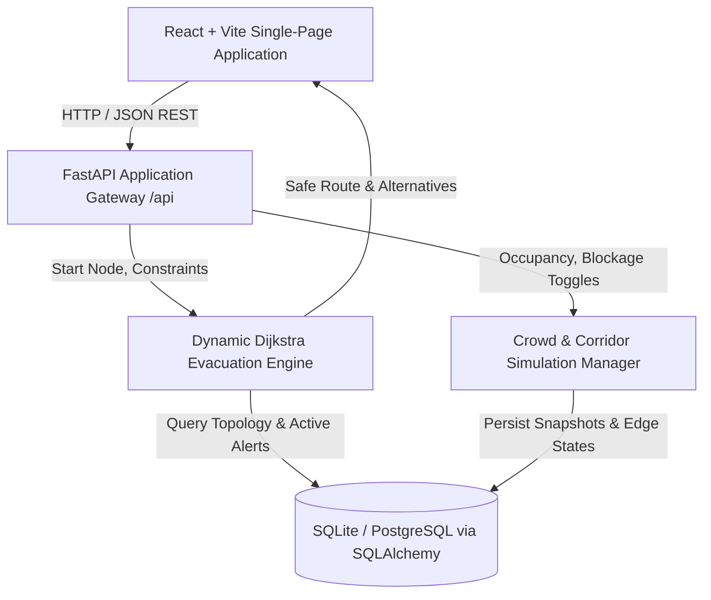
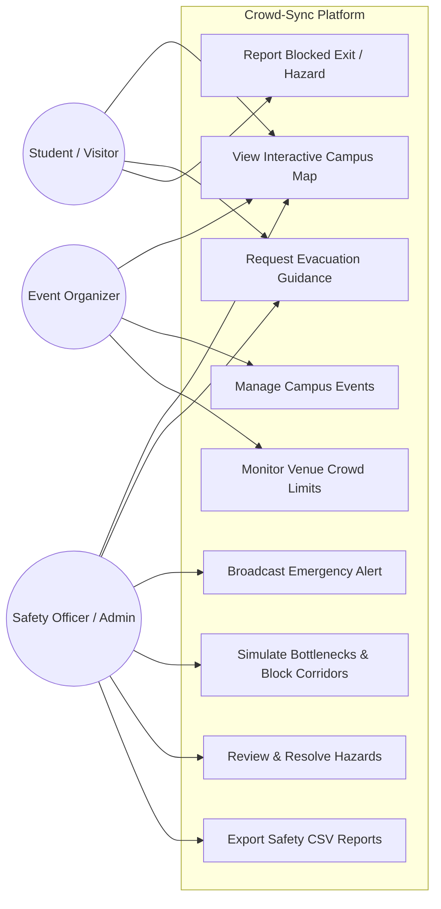
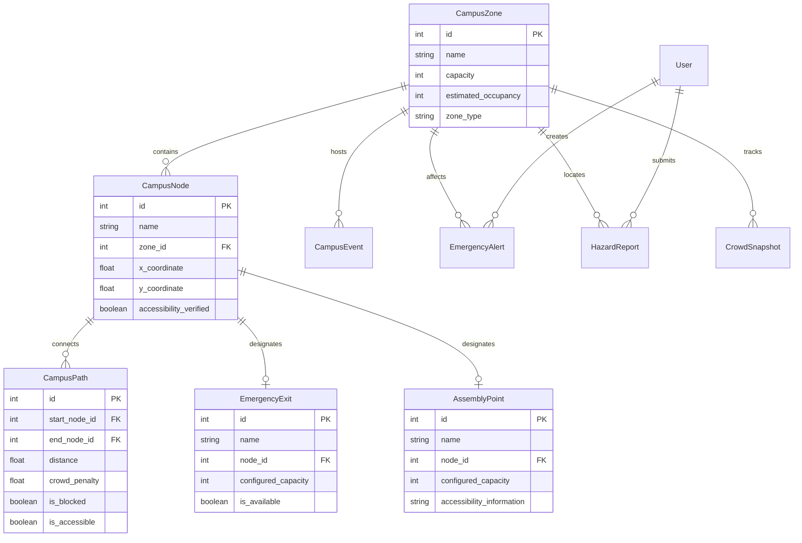
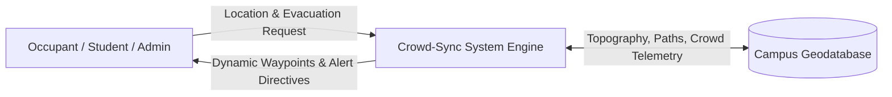
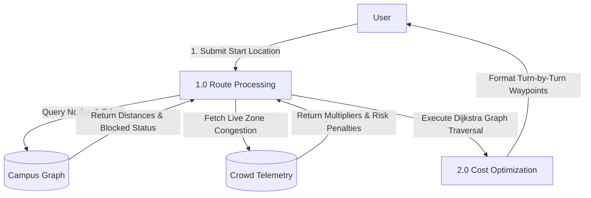
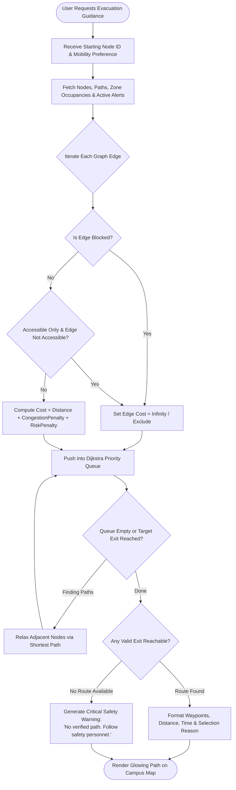

# Crowd-Sync: Campus Event Evacuation Guide
## Comprehensive Academic Project Report & Design Deliverables

---

### Abstract
College campuses host large-scale events such as technical fests, cultural symposiums, athletic meets, and convocation ceremonies. During sudden emergencies—including fire accidents, electrical short-circuits, structural failures, or crowd stampedes—panicked crowds often rush toward primary familiar exits, causing lethal bottlenecks while underutilized secondary exits remain unobstructed. **Crowd-Sync** is an intelligent, responsive campus event safety and emergency evacuation management system designed to mitigate these hazards. The system models campus geometry as an adjacency graph and employs a dynamic cost-weighted Dijkstra algorithm that evaluates distance, simulated pedestrian congestion, active hazard alerts, and verified physical corridor blockages to recommend the safest available egress route. Featuring role-based interfaces for students, event organizers, and safety wardens, Crowd-Sync bridges the critical informational gap during emergency intervals where every second counts and every exit matters.

---

### Problem Statement
Existing campus safety infrastructure relies heavily on static architectural floor plans, physical signage, and manual siren systems. These legacy mechanisms possess fundamental vulnerabilities:
1. **Static Inflexibility**: Floor plans cannot inform occupants when a specific corridor is consumed by smoke, fire, or physical debris.
2. **Herd Mentality**: Uninformed evacuees universally backtrack toward the primary entrance they arrived through, overwhelming turnstiles and gates.
3. **Decentralized Reporting**: Field hazards (e.g., collapsed staging, slippery spills, padlocked fire doors) are communicated via delayed phone calls rather than synchronized digital maps.
4. **Lack of Capacity Guardrails**: Event organizers lack real-time visibility into whether venue registrations exceed safe architectural egress capacities.

---

### Project Objectives
1. **Dynamic Graph-Based Route Optimization**: Implement a Dijkstra shortest-path engine incorporating dynamic weights ($Cost = \text{Distance} + \text{CongestionPenalty} + \text{RiskPenalty}$) that actively excludes obstructed corridors and penalizes overcrowded zones.
2. **Interactive Campus Digital Twin**: Deliver an interactive SVG campus map rendering buildings, intersections, exits, assembly points, and color-coded crowd heat overlays.
3. **Role-Based Safety Command Hierarchy**: Implement JWT-authenticated roles for Students/Visitors (route requests, hazard reports), Organizers (event planning, attendance guardrails), and Campus Safety Officers (alert broadcasts, scenario simulations, corridor blockage controls).
4. **Instant Emergency Dissemination**: Provide non-blocking emergency banner alerts with auditory-independent visual warnings.
5. **Auditable Incident Logging & Export**: Enable safety teams to download timestamped CSV audit logs detailing zone occupancies, hazard resolution logs, and evacuation path evaluations.

---

### Existing System vs. Proposed Crowd-Sync System

| Feature / Capability | Conventional Existing System | Proposed Crowd-Sync System |
|---|---|---|
| **Map Type** | Static paper/acrylic boards on walls | Interactive, zoomable digital map with live telemetry |
| **Route Guidance** | Fixed green exit arrows | Dynamic path computation rerouting around bottlenecks |
| **Hazard Adaptation** | None (evacuees blindly walk into hazards) | Obstructed paths marked $\infty$ cost; instant alternative path found |
| **Crowd Awareness** | No visibility into congestion | 4-tier density tracking (Low, Moderate, High, Critical) |
| **Incident Reporting** | Delayed manual phone calls | Instant geotagged hazard submission by students |
| **Accessibility Support**| Missing or unverified on signage | Filterable step-free wheelchair ramp verification |
| **Post-Incident Audit** | Manual paper filing | One-click exportable CSV safety audit log |

---

### System Requirements

#### Functional Requirements
- **FR-1 Authentication & RBAC**: Users must be able to register and authenticate via JWT tokens. Endpoints must enforce student, organizer, and admin access levels.
- **FR-2 Graph Topography & Map Explorer**: The system must provide an interactive 2D map displaying academic blocks, corridors, 4 perimeter exits, and 2 assembly fields.
- **FR-3 Dynamic Route Computation**: Given a starting node, the engine must evaluate available edges, apply live crowd multipliers and active alert weights, and return optimal and alternative routes.
- **FR-4 Blocked Corridor Exclusion**: Administrators must be able to toggle corridor blocked states, causing the route engine to immediately exclude those edges from calculations.
- **FR-5 Emergency Alert Broadcasting**: Safety officers must be able to create, broadcast, and resolve emergency alerts with categories (Fire, Medical, Overcrowding, Blocked Exit) and severities.
- **FR-6 Hazard Reporting**: Students must be able to log field hazard observations; safety officers must review, update status, and attach resolution notes.
- **FR-7 Capacity Guardrails**: Event creation must validate expected attendance against configured venue capacity.

#### Non-Functional Requirements
- **NFR-1 Response Latency**: Evacuation routes must compute in under 100 milliseconds for graphs with up to 500 nodes.
- **NFR-2 Usability & Contrast**: High-contrast dark navy palette with WCAG-compliant color tokens ensuring legibility under emergency conditions.
- **NFR-3 Reliability & Resilience**: System must gracefully warn users and advise on-site personnel obedience if all paths become unreachable, never fabricating an unverified route.
- **NFR-4 Security**: Passwords must be hashed using PBKDF2-HMAC-SHA256 (600,000 iterations); all inputs must be strictly validated via Pydantic schemas.

---

### System Architecture Diagram

---

### Use-Case Diagram

---

### Database Entity-Relationship (ER) Diagram

---

### Data-Flow Diagram (Level 0 Context & Level 1)

#### Level 0 Context Diagram

#### Level 1 DFD

---

### Evacuation Algorithm Flowchart

---

### Screenshots Checklist for Final Academic Project Report

- [x] **Figure 1**: Landing Page Hero with branding, headline, and 1-click Demo Role Access.
- [x] **Figure 2**: Student Safety Dashboard showing live crowd status, nearest exits, and "Start Evacuation" launcher.
- [x] **Figure 3**: Interactive Campus SVG Map showing building footprints, corridor walkways, exits, and assembly zones.
- [x] **Figure 4**: Evacuation Guidance Engine displaying optimal route to Exit C with distance, traversal time, and turn-by-turn waypoints.
- [x] **Figure 5**: Simulation Mode Demo: Corridor blocked, crowd spike at Auditorium (96%), and dynamic rerouting around bottleneck.
- [x] **Figure 6**: Crowd Monitoring Board showing Recharts 6-hour historical trend area chart and zone load bars.
- [x] **Figure 7**: Campus Safety Officer Command Center with telemetry KPIs and Emergency Alert broadcast modal.
- [x] **Figure 8**: Event Organizer Dashboard with attendance vs. capacity overload warning meters.
- [x] **Figure 9**: Safety Analytics Page with Alert Severity Pie Chart and Hazard Category Bar Chart.
- [x] **Figure 10**: Downloaded CSV Safety Audit Report opened in spreadsheet viewer.

---

### Limitations and Future Enhancements

#### Current Prototype Limitations
1. **Simulated Telemetry**: Relies on seeded and manually adjustable crowd data rather than physical IoT sensors.
2. **2D Topological Modeling**: Models campus multi-floor buildings primarily through designated ground-level building entrance portals.
3. **Indoor Positioning**: Requires manual building/corridor selection rather than Bluetooth Low Energy (BLE) or ultra-wideband (UWB) indoor beacons.

#### Future Enhancements
1. **IoT Wi-Fi / CCTV Camera Ingestion**: Incorporate live edge-AI camera vision or Wi-Fi probe density estimates to update zone occupancies automatically.
2. **Multi-Floor 3D Isometric Mapping**: Expand SVG rendering to support multi-story floorplan layers with elevator vs. stairwell egress routing.
3. **Turn-by-turn Audio Guidance**: Add voice synthesis for visually impaired students during evacuation maneuvers.
4. **Offline PWA Capabilities**: Cache local campus graph in IndexedDB for emergency routing during total cellular network outages.

---

### Conclusion
Crowd-Sync demonstrates how graph-theory algorithms, dynamic cost weighting, and modern web engineering can converge to modernize campus emergency preparedness. By replacing static floor plans with responsive, crowd-aware routing, the system addresses the real-world dangers of herd mentality and bottleneck congestion during high-stress campus events.
