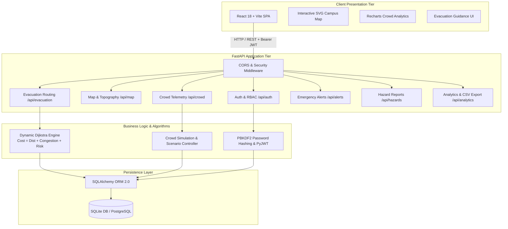

# System Architecture — Crowd-Sync

## 1. Architectural Overview

Crowd-Sync is designed around a decoupled, modern multi-tier client-server architecture:

1. **Client Tier (Frontend)**: Single-Page Application (SPA) built with React 18, Vite, TypeScript, and Tailwind CSS. Provides responsive views for students, visitors, organizers, and campus safety officers with interactive SVG graph navigation and dynamic Recharts analytics.
2. **API & Service Tier (Backend)**: Built with Python FastAPI, featuring asynchronous routing, Pydantic data validation, JWT authentication with Role-Based Access Control (RBAC), and Dijkstra-based safe route recommendation engine.
3. **Data Tier (Persistence)**: SQLite database orchestrated via SQLAlchemy ORM (configured for seamless production migration to PostgreSQL) storing campus topologies, zones, events, alerts, and hazard logs.

## 2. Key Subsystems and Interaction

### A. Graph Representation and Dijkstra Routing Service
Campus paths are represented as an adjacency-weighted undirected graph $G = (V, E)$:
- $V$ (Vertices): Building entrances, pathway intersections, emergency exits, and assembly grounds.
- $E$ (Edges): Walkable corridors and outdoor avenues.
- Dynamic Cost Function:
  $$\text{Cost}(e) = \text{Distance}(e) + \text{CongestionPenalty}(e) + \text{RiskPenalty}(e)$$
  Where:
  - $\text{CongestionPenalty}(e) = \text{Distance}(e) \times (\text{CrowdFactor} - 1.0)$
  - If $e.\text{is\_blocked} = \text{True}$, $\text{Cost}(e) = \infty$ (excluded from traversal).
  - Paths through zones with Active Critical alerts incur risk weight penalties.

### B. Crowd Simulation and Real-time Status
Zone occupancies are updated in the database and translated into density levels:
- **Low (Green)**: Occupancy $< 50\%$ of configured capacity.
- **Moderate (Yellow)**: $50\% \le \text{Occupancy} < 75\%$.
- **High (Orange)**: $75\% \le \text{Occupancy} < 90\%$.
- **Critical (Red)**: $\text{Occupancy} \ge 90\%$.

### C. Emergency Alerts and Dispatch Banner
Active critical and high severity emergency alerts are automatically propagated to all dashboards via periodic non-blocking HTTP polling, rendering an immediate high-contrast emergency banner.
