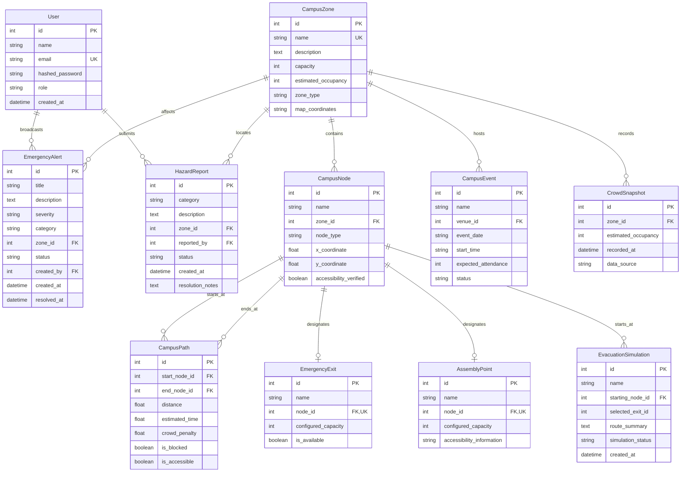

# Database Design — Crowd-Sync

## 1. Entity-Relationship (ER) Diagram

## 2. Table Specifications and Constraints

| Table Name | Description | Key Indexes & Constraints |
|---|---|---|
| `users` | Accounts for students, organizers, and admins | `email` (UNIQUE), `id` (PK) |
| `campus_zones` | Major campus sectors with capacities | `name` (UNIQUE), `capacity >= 0` |
| `campus_nodes` | Vertices in the campus routing graph | `id` (PK), `zone_id` (FK to `campus_zones.id`) |
| `campus_paths` | Bidirectional edges connecting nodes | `start_node_id` & `end_node_id` (FKs to `campus_nodes.id`) |
| `emergency_exits` | Registered campus perimeter exits | `node_id` (UNIQUE, FK to `campus_nodes.id`) |
| `assembly_points` | Safe muster fields and lawn areas | `node_id` (UNIQUE, FK to `campus_nodes.id`) |
| `campus_events` | Scheduled gatherings with venue associations | `venue_id` (FK to `campus_zones.id`) |
| `emergency_alerts` | Live emergency broadcast notices | `zone_id` (FK to `campus_zones.id`), `created_by` (FK) |
| `hazard_reports` | Field incident reports from users | `zone_id` (FK to `campus_zones.id`), `reported_by` (FK) |
| `crowd_snapshots` | Historical telemetry records for analytics | `zone_id` (FK to `campus_zones.id`), `recorded_at` (Index) |
| `evacuation_simulations`| Audit log of computed evacuation routes | `starting_node_id` (FK to `campus_nodes.id`) |
